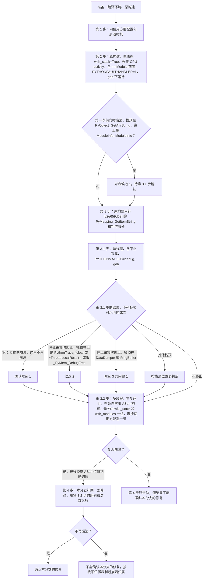

# 方案分析：定位方法、候选方案、与上游的对照

结论：

- 问题 1、2 的修改可以手工移植到上游 master。上游这两处逻辑没有变。
- 问题 3 建议以上游 `ff5ad88d8a` 为基础，并补四处修改（第 7.3 节）。
- 接手后先按第 7.1 节确认崩溃根因。根因有三个候选。在不知道配置和崩溃时机时，三者无法排序（第 1.5 节）。

说明：

- 对应提交 `663e8ba`、`f36d74d`。问题编号与 [fix_details.md](fix_details.md) 一致。术语和“状态”列的取值见 [README.md](README.md)。
- 代码事实来自本仓库 `f36d74d` 和上游文件（2026-11-02）。测量在本机 stub 环境中完成。
- 第 2、3、5 节的测量在 2026-11-02 03:58 至 04:23（`-0800`）完成。
- 这些测量晚于修复提交（`663e8ba` 02:47，`f36d74d` 03:07）和最初的文档（`675f2e9` 03:48，`da752e6` 03:51），属于事后核对。方案选择依据推理。
- 例外：第 2.1 节的 02:33 测量早于修复提交。保留 `writers_` 时参考过它。
- 第 2、3、5 节的数字和第 7.3 节建议的依据来自本机日志，不在仓库中，他人无法复现（附录）。
- 工具依赖：Linux，支持 C++17、`-fsanitize=thread`、`-fsanitize=address` 的 g++（本机为 11.4），Python 3.8 以上（只用标准库）。不需要 torch、CANN、NPU、网络。
- 本机测量都用 `systemd-run --user` 运行。在共享服务器上建议同样做。

## 1. 问题是怎么定位的

使用方没有提供调用栈和复现脚本。定位方法是静态阅读上报链路，再对每处可疑点写压力测试。

### 1.1 阅读范围和标准

阅读顺序与记录路径相同（[fix_details.md](fix_details.md) 第 2 节）。判断标准只有一条：两个线程可以同时访问同一块数据，而代码中没有同步。

### 1.2 读出的三处

| 编号 | 位置 | 同时访问同一数据的两方 |
|---|---|---|
| 问题 1 | `data_dumper.cpp`、`ring_buffer.h` | 写入方在 `Report`/`Push` 中访问缓冲区；停止方在 `UnInit` 中销毁缓冲区元素 |
| 问题 2 | `ring_buffer.h` | 多个写入方各自写槽位；读取方按公共计数 `write_index_` 判断可读槽位 |
| 问题 3 | `profiler_python.cpp` | 多个线程的回调写同一批缓存；`start/stop/clear` 与 `startOne/stopOne` 之间没有同步 |

### 1.3 为什么有 GIL 时很少暴露

本节为推断，两种构建下的暴露概率没有测量。

- 有 GIL 时，同一时刻只有一个线程执行字节码。问题 3 的共享访问基本依次发生。GIL 在字节码边界和 C 扩展释放时切换，所以回调仍可能交错。
- 问题 1、2 的写入方包括 C++ 线程（算子下发、NPU 任务队列出队）。这些线程不持有 GIL。所以问题 1、2 的修改在两种构建中都生效。
- 停止流程在已释放 GIL 的线程上执行。
- 结论：FT 构建下问题 3 从很少交错变为经常交错。问题 1、2 原来就可能发生，FT 构建下并发更高。

### 1.4 测试证明了什么

原代码 42 次场景运行全部失败，修复后全部通过。这证明三条路径有竞态。这不能证明使用方的崩溃来自哪一处。

### 1.5 漏掉的问题和三个候选

静态阅读只检查同步，漏掉了一处与线程无关的问题。修复完成后做上游对照，才找到下面两处。

1. **基线缺少上游 `b2e659d62f`**（漏掉）：3.13 及以上读 `nn.Module` 帧的 `self` 得到 NULL，随后对 NULL 取属性（第 4.2 节）。
2. **上游 issue #5658 所述路径**（`663e8ba` 已修改，当时没有列为候选）：`d3216c2` 的 `PythonTracer::clear()`（第 420–433 行）执行 `thread_local_results_.clear()`，`~ThreadLocalResult` 执行 `Py_DECREF(ctx_)`。调用方 `stopNpuProfiler()`（`npu_profiler.cpp:375` 起）在第 377 行先执行 `gil_scoped_release`，再调用 `kStop`、`kClear`。所以原代码在两种构建中都在未 attach 的线程上释放 Python 对象。状态：已验证（读代码）。

候选 1、2 在单线程、有 GIL 时也成立。候选 3（三处竞态之一）只在并发时成立。

按配置和崩溃时机排除候选（推断，依据 `d3216c2` 的代码）：

- `PythonTracer` 只在开启 `with_stack` 或 `with_modules`、并采集 CPU activity 时启动。依据：`npu_profiler.cpp` 第 95–98 行的 `tracePython()`；第 354–355 行的 `kStartAll` 和第 391–393 行的 `kStop`、`kClear` 都受它控制。
- 候选 1、2 和问题 3 都在 `PythonTracer` 中。上述条件不满足时，只剩问题 1、2。
- 3.13 及以上，`d3216c2` 的 `genPyCallHashId`（`profiler_python.cpp` 第 602–611 行）进入 `nn.Module.__call__` 帧时取得 NULL，随即执行 `ModuleInfo(NULL)`。
- 所以只要采集期间调用过任何 `nn.Module`，候选 1 就在第一次前向时发生，早于停止采集，候选 2 没有机会出现。
- 候选 2 只可能出现在采集期间没有调用过 `nn.Module` 的情况。
- `start()` 记录已有调用栈时也调用 `genPyCallHashId`（`profiler_python.cpp` 第 337 行）。如果开始采集时栈中已有 `nn.Module.__call__` 帧，候选 1 在开始采集时发生。

| 崩溃时机 | 对应候选 |
|---|---|
| 开始采集或前向中 | 候选 1；问题 2、3（需要多个写入方或多个 Python 线程同时执行） |
| 停止采集时 | 候选 2；问题 1；问题 3 中 `stop/clear` 与回调的竞争 |

只有一个 Python 线程时问题 3 不发生。问题 2 的写入方包括 C++ 线程，所以不能据此排除问题 2。

## 2. 问题 1 的候选方案

要求：`UnInit` 释放缓冲区前，确认没有写入方在 `Report` 中。`Stop` 返回后，`Flush` 写完所有已接受的记录。

### 2.1 候选对比

| 候选 | 做法 | 代价 | 结论 |
|---|---|---|---|
| A 互斥锁 | `Report` 和 `Stop` 持同一把锁 | 所有写入方串行，锁所在缓存行争用。`std::mutex` 在 glibc 上 40 字节。 | 放弃。正确、易检查，但多线程上报串行化。 |
| B 读写锁 | `Report` 共享持有 `std::shared_mutex`，`Stop` 独占获取一次 | 共享获取修改读者计数，仍争用同一缓存行，开销高于 E（推断）。56 字节。 | 放弃。结构与 E 相同，计数放进锁里。 |
| C 缓冲区只分配一次 | `UnInit` 不释放，下次 `Init` 复用 | 两个 2^20 槽位的缓冲区一直占用（原格式 16 MB，Vyukov 格式 32 MB）。`Stop` 检查后才完成的记录写进下一次采集的目录。下次 `Init` 清空槽位又与这些写入竞争。`is_inited_` 的竞争仍在。 | 放弃。 |
| D `shared_ptr` 原子替换 | `Report` 用 `std::atomic_load` 取引用；`Stop` 用 `std::atomic_exchange` 置空 | GCC 11 的 `atomic_load` 内部获取 libstdc++ 的互斥锁（`_Sp_locker`），GCC 11 没有 `std::atomic<std::shared_ptr>`。另有两次引用计数的原子读-改-写。`Stop` 仍要等引用计数降到 1，等价于 E 的等待。没有实测。 | 放弃。 |
| E `writers_` + `seq_cst`（采用） | 见 [fix_details.md](fix_details.md) 问题 1 | 每次 `Report` 多两次原子读-改-写，同一缓存行争用。未采集时没有额外开销。每个上报器 8 字节。正确性依赖 `seq_cst`。 | 采用。依据是设计推理：`Report` 不取锁；只改 `data_dumper.h/.cpp`。 |
| F 每个写入方一个 SPSC 缓冲区 | 读取方轮流读各缓冲区 | 内存为线程数乘以容量，按现有 2^20 槽位不可接受。要处理线程退出、注册表重置、轮询。跨线程顺序不再保留，下游是否依赖未验证。 | 放弃。如果在 NPU 上测出 `writers_` 争用明显，可以考虑。 |

- 如果维护者不接受手写内存序，B 是最接近的替代。
- A 在仓库中有先例。`ProfilerMgr::UploadWithLock`（`profiler_mgr.cpp`）对 `dataReceiverWithLock_` 的每次 `Report` 持有 `reportDataMutex_`。
- `StopDataReceiver` 不取这把锁，所以它防不住问题 1。只修这一个上报器时，可以让停止方也取 `reportDataMutex_`。
- `dataReceiver_`（算子记录，`npu_profiler.cpp:298`）和 `traceDataReceiver_` 没有这把锁。这一做法没有实现和测试。
- glibc 读写锁默认偏向读者（`pthread.h`：`PTHREAD_RWLOCK_DEFAULT_NP = PTHREAD_RWLOCK_PREFER_READER_NP`）。写入方持续上报时，`Stop` 可能等待较久。这一点没有测量。libstdc++ 的 `std::shared_mutex` 是否用默认类型，未验证。
- E 与参照变体单线程范围重叠：4.48 到 5.13（4.86）对 2.57 到 5.50（4.66）。
- 02:33 的测量（同一机器，每组 3 次）中，单线程两组不重叠：有 `writers_` 为 4.32 到 4.73，无 `writers_` 为 4.91 到 4.93。

### 2.2 `Report` 基准

单位为百万次/秒。5 次重复，最小值到最大值，括号内为中位数。方法见第 6 节。采用方案、互斥锁、读写锁都是有效修复。“参照”只去掉 `writers_` 登记和 `WaitWriters`，不是有效修复。

| 写入方数 | 变体 | `Report` 调用速率 | 接受速率 |
|---|---|---|---|
| 1 | 采用方案 | 4.48 到 5.13（4.86） | 4.48 到 5.13（4.87） |
| 1 | 互斥锁 | 3.09 到 5.12（4.77） | 3.09 到 5.12（4.78） |
| 1 | 读写锁 | 3.68 到 5.07（4.45） | 3.69 到 5.07（4.45） |
| 1 | 参照 | 2.57 到 5.50（4.66） | 2.57 到 5.50（4.66） |
| 8 | 采用方案 | 3.86 到 4.32（3.98） | 2.02 到 2.16（2.08） |
| 8 | 互斥锁 | 1.37 到 2.37（2.11） | 1.37 到 2.37（2.11） |
| 8 | 读写锁 | 2.40 到 3.73（3.49） | 2.24 到 2.49（2.35） |
| 8 | 参照 | 3.78 到 5.27（4.89） | 1.91 到 2.21（2.08） |
| 32 | 采用方案 | 2.40 到 4.05（3.78） | 1.26 到 1.49（1.33） |
| 32 | 互斥锁 | 1.17 到 1.31（1.26） | 1.17 到 1.31（1.26） |
| 32 | 读写锁 | 1.79 到 3.20（3.06） | 1.41 到 1.61（1.46） |
| 32 | 参照 | 2.49 到 5.25（4.34） | 1.29 到 1.33（1.32） |

- 单线程时四个变体范围重叠。
- 8、32 个写入方时，接受速率都在 1.1 到 2.5 之间。总速率受读取方限制，多出的调用因缓冲区写满而丢弃。
- 互斥锁的接受速率与采用方案相当（8 个写入方时中位数 2.11 对 2.08）。它的调用速率低，因为它几乎不丢弃。

> [!WARNING]
> 不要用调用速率比较单次开销。调用速率包含写满后直接失败的调用，各变体的丢弃比例不同。
> 按中位数估算（无出处）：8 个写入方时采用方案约 48%、读写锁约 33%；32 个时约 65% 对 52%。
> 所以这组数据不能区分采用方案与读写锁的单次调用开销。

## 3. 问题 2 的候选方案

要求：读取方只读已写完的槽位。同一写入方的记录按写入顺序取出。

### 3.1 候选对比

| 候选 | 做法 | 代价 | 结论 |
|---|---|---|---|
| A 互斥锁 + `std::deque` | 同一把锁内操作 `deque`，满时返回 false。98 行，线性一致。 | 读取方与写入方争锁。内存随元素数增长。 | 放弃。多线程下取出速率下降，丢弃增多。 |
| B 按占用顺序发布 | 写完后等 `write_index_` 等于自己的位置再加 1，约 3 行 | 调度器在一个写入方占用后、发布前挂起它时，后面所有写入方无上限等待（`cycle_limit` 只限占用阶段）。FT 下线程数可能超过核数。 | 放弃。没有实现。 |
| C 每槽位一个 `ready` 标志 | 保留原占用和判满逻辑，加 `atomic<bool> ready` | 写入方判满时读 `read_index_`，有缓存行争用。“空闲”和“已写完”由两个变量表示，要单独论证顺序。 | 放弃。 |
| D Vyukov 队列，单读取方（采用） | 见 [fix_details.md](fix_details.md) 问题 2。179 行，接口不变。 | 一次 CAS 争用 `write_index_`。每槽位 16 字节，共 32 MB，预先分配。 | 采用。读取方不加锁；不需要第三方代码；有公开原文可对照。代价是内存翻倍。 |
| E 每个写入方一个 SPSC 队列 | 同问题 1 的 F | 同问题 1 的 F | 放弃。没有实现。 |
| F 第三方库 | 见下表 | 需要新增依赖 | 放弃。 |

- `Report` 基准中，A 的接受速率在 8 个写入方时为 1.23 到 1.34，32 个时为 1.09。采用方案为 2.02 到 2.16 和 1.26 到 1.49。
- 单线程时 A 的调用速率为 1.84 到 3.27，采用方案为 4.48 到 5.13。原因：读取方与写入方在同一把锁上交替。

| 库 | 许可证 | 最近推送 | 与本场景的差距 |
|---|---|---|---|
| moodycamel `ConcurrentQueue` | 简化 BSD 或 BSL-1.0 | 2026-10-26 | 单个头文件。不是线性一致的，只保证同一写入方按顺序出队。 |
| folly `MPMCQueue` | Apache-2.0 | 2026-11-02 | 线性一致。依赖 folly 的其他头文件。 |
| `boost::lockfree::queue` | BSL-1.0 | 2026-10-25 | 要求元素可平凡复制和析构，`std::unique_ptr` 不满足。 |
| rigtorp `MPMCQueue` | MIT | 2024-03-08 | 只查了许可证和日期。 |
| max0x7ba `atomic_queue` | MIT | 2026-10-23 | 只查了许可证和日期。 |

- 推送日期由 GitHub API 在 2026-11-02 查询。
- 这些库都不在 `third_party/` 或 `.gitmodules` 中。`CONTRIBUTING.md` 没有写新增第三方代码的规则。
- 放弃原因：需求固定（有界、单读取方、存 `unique_ptr`），队列只有 179 行。新增依赖需要上游维护者同意。
- moodycamel 与本场景的差距最小。它会改变跨写入方的出队顺序，下游是否依赖这一顺序没有核实。

### 3.2 队列基准

单位为百万次/秒。5 次重复，最小值到最大值，括号内为中位数。

| 容量 | 写入方数 | 变体 | 写入成功速率 | 1 秒内取出速率 |
|---|---|---|---|---|
| 2^20 | 1 | 采用方案 | 3.65 到 8.04（5.56） | 3.65 到 8.04（5.56） |
| 2^20 | 1 | mutex+deque | 3.57 到 5.48（4.13） | 3.57 到 5.48（4.13） |
| 2^20 | 8 | 采用方案 | 2.97 到 4.00（3.78） | 2.82 到 4.00（3.65） |
| 2^20 | 8 | mutex+deque | 1.47 到 1.70（1.64） | 0.42 到 0.65（0.59） |
| 2^20 | 32 | 采用方案 | 1.54 到 2.72（1.63） | 1.54 到 2.41（1.63） |
| 2^20 | 32 | mutex+deque | 1.14 到 1.21（1.16） | 0.09 到 0.16（0.11） |
| 1024 | 1 | 采用方案 | 5.19 到 8.28（6.35） | 5.19 到 8.28（6.35） |
| 1024 | 1 | mutex+deque | 2.37 到 5.39（3.84） | 2.37 到 5.39（3.84） |
| 1024 | 8 | 采用方案 | 2.18 到 3.90（3.65） | 2.18 到 3.90（3.65） |
| 1024 | 8 | mutex+deque | 0.41 到 0.77（0.65） | 0.41 到 0.77（0.65） |
| 1024 | 32 | 采用方案 | 0.38 到 2.66（1.14） | 0.38 到 2.66（1.14） |
| 1024 | 32 | mutex+deque | 0.11 到 0.18（0.14） | 0.11 到 0.18（0.13） |

- 两个变体所有运行的错序和丢失计数都为 0。采用方案在 8、32 个写入方、容量 2^20 时写入从未失败。
- 容量 2^20、8 和 32 个写入方时，mutex+deque 的取出速率中位数约为采用方案的 0.16 倍和 0.07 倍，范围不重叠。
- 原 ring buffer 在容量 1024、8 和 32 个写入方时出现错序，单次最多 834 条。8 和 32 个写入方的各组都出现取出数少于写入成功数。丢失的成因没有分析。

## 4. 问题 3 的候选方案和与上游的对照

要求：并发执行回调、`startOne` 和控制操作时，两个线程不同时修改共享容器；回调不访问 `clear()` 已释放的对象；`stop()` 返回后没有线程仍安装着本 tracer 的回调。问题 3 的候选之间没有做性能对比。

### 4.1 上游改了什么

- `Ascend/pytorch` master（2026-11-02 的 HEAD 为 `790544fa`）的 `profiler_python.cpp` 最后由 `ff5ad88d8a` 修改（2026-10-29，`!48607`，分支 `gilmemory`，只改这一个文件，+360/−240）。
- 关联 issue #5658（gitcode，2026-10-26 创建，查看时为 open）：开启 `with_modules=True` 后停止 profiler 时，在没有持有 GIL 的情况下释放 `TraceContext`；开启 `PYTHONMALLOC=debug` 时必定 coredump。
- PR 描述列出五条修改：3.13 及以上改用 `PyEval_SetProfileAllThreads`，不再用 `PyThreadState_Swap`；缓存和事件移进每线程的 `ThreadLocalResult`；FT 3.14 及以上读初始栈时用 STW；`stop()` 先标记不活跃、清除回调，再释放 GIL 等每个线程的回调锁；所有线程共用一个 `TraceContext`。
- PR 的“功能验证”只有一张截图，没有查看。上游是否有 FT 测试，未验证。

| 事实 | 状态 |
|---|---|
| `6ca3a36a15`（2026-10-26）对这个文件只改一行 `#include`：把 `npu_profiler.h` 换成 `profiler_callbacks.h`。`TraceTag`、`TraceEvent` 移到新文件 `python_tracer_types.h` | 已验证 |
| `94dd5bf251`（2026-10-27）对这个文件只改一行 `#include`：把 `profiler/utils.h` 换成 `profiler/python/python_frame_utils.h` | 已验证 |
| `ff5ad88d8a` 之后，`profiler_python.cpp`、`profiler_python.h`、`python_tracer_types.h`、`python/python_frame_utils.h` 在 master 上没有新提交（2026-11-02 用 GitHub API 按路径查询） | 已验证 |
| 移植到 2.13.0 时主要是把这两行 `#include` 换回旧路径，并确认 2.13.0 的 `profiler_python.h` 仍声明 `TraceEvent` | 推断，没有编译 |
| 新引用的 `torch/csrc/utils/pythoncapi_compat.h`、`torch/csrc/Exceptions.h` 在 2.13.0 中是否可用 | 未验证 |

### 4.2 与线程无关的问题：基线缺少 `b2e659d62f`

上游 `b2e659d62f`（2026-08-21，`!43955`，issue #3808，已关闭）把 `PyDict_GetItemString` 改为 `PyMapping_GetItemString`。原因：3.13 起 `PyFrame_GetLocals` 返回 `PyFrameLocalsProxy_Type` 实例。它还修复了 3.12 下 `with_stack` 的析构错误。

本分支（`d3216c2` 和 `f36d74d` 相同）用 `PyDict_GetItemString(f_locals, "self")` 读 `nn.Module.__call__` 帧和 `Optimizer` step 帧的 `self`（`f36d74d` 第 837、853 行），取不到时不判空。状态：已验证。

```cpp
auto module_class = PyDict_GetItemString(f_locals, "self");
hash_id = c10::get_hash(module_class);
...
ModuleInfo module_info(module_class);   // 构造函数里执行 py::handle(module_class).attr("__class__")
```

用 ctypes 调用同样的 C API（已验证）：

| Python | `PyFrame_GetLocals` 的类型 | `PyDict_GetItemString` | `PyMapping_GetItemString` |
|---|---|---|---|
| 3.14.3t（FT） | `FrameLocalsProxy` | NULL | 返回 `self` |
| 3.14.3（GIL） | `FrameLocalsProxy` | NULL | 返回 `self` |
| 3.12.13（GIL） | `dict` | 返回 `self` | 返回 `self` |

3.14.3 和 3.14.3t 是 python-build-standalone 构建。3.12.13 的来源没有记录。

| 事实 | 状态 |
|---|---|
| 3.14.3t 上 `PyObject_GetAttrString(NULL, "__class__")` 以 SIGSEGV 退出（退出码 139）。输出只记录了 `exit=139`，没有记录 `sys.version` 和 `Py_GIL_DISABLED`，所以“在 3.14.3t 上”无法从日志核对。重新运行时记录这两项。 | 已验证 |
| pybind11 的 `handle(nullptr).attr` 调用这个函数 | 推断 |
| 3.13 及以上开启 `with_stack` 或 `with_modules`，第一次 `nn.Module` 调用时崩溃，与线程数无关，GIL 构建同样成立。3.13 没有实测，依据 PEP 667。 | 推断 |
| 3.13 及以上，开启 `with_stack` 或 `with_modules`，且 `record_params_` 为真时（`profile_memory` 且 `record_shapes`），Optimizer 分支对 NULL 调用 `parseOptimizerParams` | 推断 |
| `ff5ad88d8a` 保留 `PyMapping_GetItemString`，取不到时抛 `KeyError`；去掉“3.12 及以上跳过 `Py_DECREF`”，改由 `releaseContext()` 持 GIL 释放共享 ctx | 已验证 |

- 使用方的现象与这条路径相符。但没有在 torch_npu 上运行确认。
- 如果崩溃出在这里，gdb `bt` 的栈顶在 `PyObject_GetAttrString`，往上是 `ModuleInfo::ModuleInfo`。
- 压力测试没有发现它。原因：stub 的 `py::handle::attr` 不访问对象。

### 4.3 候选对比

| 候选 | 做法 | 代价 | 结论 |
|---|---|---|---|
| A 一把全局锁 | 回调和控制操作取同一把锁 | 持锁时执行 CPython 调用，回调完全串行。同线程再次进入 tracer 时，不可重入锁死锁；可重入锁则在容器修改一半时重入。 | 放弃。B 是它的收窄版本。 |
| B 三把 `PyMutex` + 会话计数（采用） | 见 [fix_details.md](fix_details.md) 问题 3 | 每次 Python 调用至少获取两次 `data_mutex_`，所有线程共用 | 采用。不改数据结构；只用 3.13 起公开的 `PyMutex`；GIL 构建不受影响。 |
| C 每线程缓存（上游 `ff5ad88d8a`，796 行） | 见第 4.4 节 | 每个事件仍获取一次全局 `results_mutex_`。缓存按线程重复，停止时去重。 | 当时没有查到它，移植等于替换整个文件（[learning.md](learning.md) B4）。现在建议以它为基础。 |
| D STW 私有 API | 控制操作在 `_PyEval_StopTheWorld` 与 `_PyEval_StartTheWorld` 之间执行 | 只保护控制操作。私有 API 不在稳定接口内。 | 放弃作为主要手段。 |
| E critical section | 用 `Py_BEGIN_CRITICAL_SECTION_MUTEX`（3.14）或 `Py_BEGIN_CRITICAL_SECTION`（3.13）包住容器访问 | 锁内调用的 C API 阻塞时，运行时挂起 critical section 并释放锁。所以它不提供 `PyMutex` 那样的互斥访问（`Doc/c-api/synchronization.rst`）。容器操作不调 C API，`PyMutex` 已能满足。如果把 CPython 调用放进锁内，又会遇到挂起期间容器状态被其他线程修改的问题。 | 放弃。 |

- A：用 `std::mutex` 时等锁线程保持 attach，阻塞 STW。持锁线程如果在等这次 STW，就死锁。这一条按代码分析得出，没有测试。
- D：3.14 公开文档没有这两个函数。3.14.3 在 `internal/pycore_pystate.h` 中声明，标了 `PyAPI_FUNC`，`libpython3.14t.so` 导出它们（已验证）。3.15 和其他平台未验证。B 只用公开的 `PyEval_SetProfileAllThreads`，代价是 FT 下无法遍历其他线程的栈。

### 4.4 两种设计逐项对照

行号：上游指 master 的 `profiler_python.cpp`，本分支指 `f36d74d`。

| 方面 | 本分支（`f36d74d`） | 上游（`ff5ad88d8a`） |
|---|---|---|
| 缓存和事件 | `PythonTracer` 成员，所有线程共用 | 每个线程一份 `ThreadLocalResult`（178–202 行）；停止时遍历并按 hash 去重 |
| ctx | FT：`start()` 装一个共享 ctx，`startOne` 各建一个。GIL：每线程一个。ctx 内含 `std::atomic<PythonTracer*> tracer_` | 两种构建都只有一个 `shared_ctx_`，由 `PythonTracer` 持有唯一引用 |
| 回调找本线程数据 | 不查找，用 `ctxKey(ctx)` 区分线程 | `findThreadLocalResult(PyThreadState_Get())` 查 `unordered_map` 并复制 `shared_ptr`（458–464、721 行） |
| 锁 | `control_mutex_`、`registration_mutex_`、`data_mutex_`，都是 `PyMutex`，等锁时 detach | `control_mutex_`（五个入口都取）、`results_mutex_`、`report_mutex_`、每线程 `callback_mutex_`，都是 `std::mutex`，等锁时不 detach。`lockControl` 等锁前先释放 GIL（406–413 行） |
| 锁在哪种构建生效 | 只在 FT 构建 | `results_mutex_` 只在 FT 构建；其余三把两种构建都生效 |
| 控制操作 | `start/stop/clear` 依次执行，`startOne/stopOne` 不取 `control_mutex_` | `stop()` 先置 `active_ = false`、清除所有回调，再释放 GIL，逐个获取 `callback_mutex_` 并置 `enabled_ = false`（446–456 行） |
| `stop()` 之后才登记的子线程 | `startOne` 记下 `session_`，装好回调后再检查，已变化就移除，最多重试一次 | `startOne` 整个函数体持有 `control_mutex_`，在锁内检查 `active_`（335–359 行） |
| 开始采集时记录已有调用栈 | FT：只记录当前线程。GIL：沿用 `PyThreadState_Swap` | FT 3.14 及以上：在 STW 期间枚举所有线程（306–318 行）。GIL：同样枚举 |
| CPython 私有接口 | 不调用私有函数。直接读 `c_profilefunc`（第 518、592、628 行，上游和 `d3216c2` 也读）和 `c_profileobj`（第 560 行，只有本分支读）。字段在 `Include/cpython/pystate.h` 的 `struct _ts` 中（3.14.3 第 134、136 行），布局不属于稳定接口（已验证） | FT 3.14 及以上：`_PyEval_StopTheWorld`，自行 `extern "C"` 声明（60–62 行）。3.9–3.12：`_PyEval_SetProfile` |
| GIL 构建的行为变化（推断） | 只有 `clear()` 改为获取 GIL | 不再有 `max_threads`（原默认 256）；`stop()` 清除其他工具的 profile 函数；每个事件多一次查表、`shared_ptr` 复制和 `try_lock` |
| FT 热路径 | 每次调用至少两次 `data_mutex_`；`nn.Module` 帧多一次（第 851–859 行）；到阈值时在锁内上传 | 每个事件一次 `results_mutex_`，一次本线程 `callback_mutex_` 的 `try_lock`（获取失败时不记录）。上传时取 `report_mutex_` |
| 3.13 及以上读 `self` | `PyDict_GetItemString`，返回 NULL | `PyMapping_GetItemString`，取不到时抛 `KeyError`，由 `catch (...)` 丢弃（640–681、752 行） |
| ctx 释放时持有 GIL（#5658） | 是，`clear()` 获取 GIL | 是，`releaseContext()` 获取 GIL（424–430 行） |
| 3.13t | 与 3.14t 同一套代码 | 只告警 `"The Python tracer is not thread-safe on Python 3.13t. Please use Python 3.14t or later."`，不做 STW |
| 同线程重入 | `control_mutex_` 检测到同线程重入时抛出异常。`startOne/stopOne` 不取 `control_mutex_`，可以从 `start()` 的帧遍历中调用 | 没有检测。同一线程对 `std::mutex` 再次加锁是未定义行为，glibc 上死锁（第 5.3 节已复现） |

### 4.5 本分支修复中出现过的竞态，上游是否处理

本分支修复过程中出现过六类竞态（[learning.md](learning.md) B1）。

| 竞态 | 上游 | 状态 |
|---|---|---|
| 两个线程并发 `start/stop` | 已处理：五个入口都取 `control_mutex_`（281、337、363、380、392 行），等锁前释放 GIL（410 行） | 推断。测试没有覆盖同时 `stop` |
| `stop()` 之后才 `startOne`，留下回调 | 已处理：`startOne` 在锁内检查 `active_`（338 行），也在锁内安装回调（358 行） | 已验证。18 次运行中 `stale_hooks_after_stop` 都是 0；去掉锁后检查失败（第 5.5 节 u3） |
| `clear()` 释放 `ThreadLocalResult` 时回调仍在使用 | 已处理：回调持有 `shared_ptr`（721 行），`clear()` 只清空容器中的引用（396–398 行）；`stop()` 用 `callback_mutex_` 等回调退出（451–455 行） | 推断。扩展场景中去掉 `callback_mutex_` 后 TSan 报竞争（第 5.5 节 u2），保留时 9 次运行没有报告 |
| `recordReturn` 等锁后才读 ctx | 结构上不存在：`recordReturn` 不用 ctx，线程 id 存在 `tls.tid_`（555 行） | 推断（读代码）。已验证（压力测试）：扩展场景中回调中途 detach，上游 TSan、ASan 各 3 次没有报告 |
| 线程 id 重用 | 已处理：按 tstate 地址登记（317、355 行）；新 tstate 不继承 profile 函数 | 已验证（读 CPython v3.14.3 源码：`Python/legacy_tracing.c` 576–594 行，`Python/pystate.c` 1796–1805 行） |
| `recordStartStack` 抛 Python 异常 | 已处理：`start()` 出错时清除回调和登记表再抛出（319–330 行） | 推断。差异：上游任何线程的帧解析失败都让 `start()` 失败 |

上游的残留问题（推断）：`tls->context_ != ctx`（722 行）只比较指针。新一轮 `shared_ctx_` 分配在旧地址时，上一轮较慢的回调会多写一条事件。这不会访问已释放内存。

### 4.6 风险对照

| 方案 | 风险 | 状态 |
|---|---|---|
| 上游 | 同线程重入时死锁：`start()` 持锁执行 `captureStartFrames`，用户代码可能再调用 `startOne/stopOne` | 已验证（第 5.3 节）。实际出现的可能性很低（推断） |
| 上游 | 回调持有 `callback_mutex_` 时调用 `stop/startOne`，与 `stop()` 互相等待 | 未验证 |
| 上游 | STW 期间执行 Python 对象操作（取类名、读 `_parameters`、`param_groups`、`state.get`）。如果执行了字节码且有待执行的垃圾回收，会嵌套请求 STW 并死锁 | 推断 |
| 上游 | 依赖 `_PyEval_StopTheWorld`，CPython 升级时可能失效 | 3.14.3 已导出；以后版本未验证 |
| 上游 | GIL 构建行为变化（第 4.4 节） | 读代码，没有运行 |
| 上游 | 3.13t 只告警，仍有读其他线程栈的竞态 | 读代码 |
| 上游 | FT 构建每个事件取一次全局 `results_mutex_` | 读代码；stub 吞吐见第 5.4 节 |
| 上游 | 等 `results_mutex_` 时不 detach。以后在持有它时引入 Python 调用或 STW 会死锁 | 推断 |
| 本分支 | 缺少 `PyMapping_GetItemString` 修改 | C API 行为已验证；torch_npu 未验证 |
| 本分支 | 读 `c_profilefunc`、`c_profileobj`，布局可能随小版本变化 | 读代码 |
| 本分支 | FT 下每次调用至少两次全局 `data_mutex_` | 第 5.4 节 |
| 本分支 | `session_` 逻辑复杂；两轮 stop/start 期间漏采一个线程 | 代码注释已写明 |
| 本分支 | 与上游结构不同，以后同步要手工合并 | 已验证 |
| 本分支 | 锁只在 FT 构建生效，GIL 构建依赖 GIL。GIL 构建只编译，没有运行 | [fix_details.md](fix_details.md) 第 4.4、5.2 节 |
| 两者 | FT 下 `stop()` 清除所有线程的 profile 函数；stub 与真实 CPython 不一致；上游没有在 NPU 上运行；本分支 `9f34a2a` 在 NPU 上运行过 `npu_check.py`，没有专门测试这一行为 | 读代码 |

嵌套 STW 的依据（读 CPython v3.14.3 源码，没有运行）：`stop_the_world()` 先执行 `PyMutex_Lock(&stw->mutex)`（`pystate.c` 2372 行），不可重入。FT 的垃圾回收调用 `_PyEval_StopTheWorld`（`gc_free_threading.c` 2185 行），由 `_Py_ScheduleGC` 推迟到线程处理待办事件时执行（2152 行）。`sys._current_frames()` 也在 STW 期间读帧（推断）。“STW 期间执行字节码”没有找到先例。

## 5. 用本仓库的压力测试运行上游版本

### 5.1 做法

- 在测试代码的副本中运行，仓库中的测试没有修改。同一份测试和 stub 分别编译上游 master 的文件（原样）和 `f36d74d` 的文件。
- 场景与 `python_tracer/python_tracer_test.cpp` 相同：worker 循环执行回调和 `kStartOne/kStopOne`；主线程释放 GIL 后循环执行 `kStartAll/kStop/kClear`；每次 `kStop` 后检查没有残留回调。
- stub 的 `PyEval_SetProfile` detach 最多 2 ms，模拟 3.14 的 STW（3.14.3 在 `legacy_tracing.c` 551–554 行调用 `_PyEval_StopTheWorld`，已验证）。
- 为编译上游版本，stub 补充了 3.14 版本宏、STW 函数、线程栈枚举，以及与 3.14 一致的 `PyDict_GetItemString`（返回 NULL）和 `PyMapping_GetItemString`。补充内容对两个版本相同。

| 模式 | 内容 |
|---|---|
| 含重入 | 主线程在 `kStartAll` 的帧遍历中调用 `kStartOne/kStopOne` |
| 不含重入 | `PYTRACER_NO_REENTRY=1` |
| 扩展 | 不含重入，加 `PYTRACER_HOOK_DETACH=1`（回调中途 detach）和 `PYTRACER_LATE_THREADS=1`（不断创建短生命周期线程，tstate 地址会重复）。第 5.5 节发现原场景测不到两把锁后才加入。 |

- 判定规则与 `run.py` 相同。TSan、ASan 构建 6 个 worker，plain 构建 8 个，都是 100 轮。超时：原场景 60 秒，扩展 90 秒。

### 5.2 公平性

- stub 不模拟 GIL，两边的 GIL 构建都没有运行。stub 不执行用户代码，测不到 STW 期间执行字节码的风险。
- 扩展模式第一次运行出现的 TSan 报告来自测试本身（新线程在 attach 前写帧）。改正后报告消失，那次日志已删除。
- 上游 `start()` 遍历 worker 的栈，本分支只遍历主线程。两边执行路径不同，这是设计差别。

### 5.3 结果

2026-11-02，本机。“失败次数 / 运行次数”，每次 100 轮。

| 模式 | 构建 | 上游 | 本分支 |
|---|---|---|---|
| 不含重入 | TSan / ASan / plain | 0/3，0/3，0/3 | 0/3，0/3，0/3 |
| 含重入 | TSan / ASan / plain | 3/3，3/3，3/3（均超时） | 0/3，0/3，0/3 |
| 扩展 | TSan / ASan / plain | 0/3，0/3，0/3 | 0/3，0/3，0/3 |

- 所有通过的运行中，`stale_hooks_after_stop` 都是 0。
- 扩展模式每次创建的短生命周期线程：TSan 构建 140–248 个，ASan 构建 462–611 个，plain 构建 506–853 个。
- 前两组在加入扩展模式之前运行。扩展代码默认关闭，不影响它们。
- 含重入的挂起位置由一个诊断版本打印（plain 构建，10 秒没有进展就退出）。上游 3 次都在第 0 轮挂起：

  ```
  {"scenario": "pytracer-watchdog", "passed": false, "hang": true, "cycles_done": 0, "reentries": 1, "main_thread_in": "re-entrant kStartOne inside kStartAll"}
  ```

- 即主线程持有 `control_mutex_` 时再次获取它。本分支 3 次都通过（`reentries` 为 200）。TSan 构建没有输出死锁报告。本机没有 gdb。

### 5.4 回调吞吐

做法：`python_tracer_test bench <线程数> 1000`，回调循环 1 秒，统计所有线程合计的百万次/秒。每点 3 次，plain 构建，系统负载没有记录。“模块帧”是 stub 默认，每帧都当作 `nn.Module.__call__` 帧。“普通帧”设 `PYTRACER_BENCH_PLAIN_FRAMES=1`。真实场景中大部分帧属于普通帧（推断）。

| 线程数 | 普通帧：上游 | 普通帧：本分支 | 模块帧：上游 | 模块帧：本分支 |
|---|---|---|---|---|
| 1 | 4.6–4.8 | 5.5–7.2 | 3.8 | 4.2–4.3 |
| 2 | 4.3–5.8 | 2.3–3.5 | 3.2–6.1 | 2.9–3.3 |
| 4 | 3.5–4.8 | 2.0–2.2 | 3.1–4.6 | 1.9–2.0 |
| 6 | 3.0–3.2 | 1.3–1.4 | 3.1–4.0 | 1.3–1.5 |
| 8 | 2.4–3.2 | 1.2–1.6 | 3.1–3.6 | 1.0–1.2 |

- 单线程时本分支更快。原因（推断）：上游每个事件多一次查表、复制和 `try_lock`。
- 普通帧从 2 个线程起、模块帧从 4 个线程起，上游更快，范围不重叠。模块帧 2 个线程时重叠（3.198–6.137 对 2.927–3.278）。
- 6–8 个线程时，按范围端点计算，上游是本分支的 1.57–3.51 倍。最小值为 8 线程普通帧（2.441/1.550），最大值为 8 线程模块帧（3.631/1.036）。
- 两边的合计吞吐都不随线程数增长。瓶颈（推断）分别是 `results_mutex_` 和 `data_mutex_`。

> [!WARNING]
> 这组数字只能比较相对趋势。stub 用 `std::mutex` 模拟 `PyMutex`，用 `ostringstream` 计算 hash。
> 同一配置 3 次之间最多相差约一倍。这组与 [fix_details.md](fix_details.md) 第 5.2 节的数字不能互相换算。

### 5.5 变异检查

对上游代码各做一处修改。编号 u1–u3 与 [learning.md](learning.md) A4.3 的 m1–m11 不是同一套。表中为“发现次数 / 运行次数”。

| 变异 | 修改 | 原场景：TSan，plain | 扩展：TSan，ASan |
|---|---|---|---|
| u1 | `findThreadLocalResult` 不取 `results_mutex_` | 0/3，0/3 | 3/3，0/3 |
| u2 | 回调不取 `callback_mutex_`，同时去掉 `enabled_` 检查 | 0/3，0/3 | 3/3，0/3 |
| u3 | `startOne` 不取 `control_mutex_` | 3/3，3/3 | 没有运行 |

- u2 同时去掉两处，因为 `enabled_` 只在持锁时检查才有意义。
- 原场景测不到 u1：worker 都在 `start()` 前创建，哈希表结构不变。测不到 u2：回调不中途 detach，STW 已足够。
- 扩展模式下 u1 的 TSan 报告是 `unordered_map::find` 与 `operator[]` 竞争，u2 是读事件列表与 `emplace_back` 竞争。
- u3 的 `stale_hooks_after_stop`：TSan 构建 11–23，plain 构建 78–104。

> [!CAUTION]
> 只有 TSan 构建能发现 u1、u2。上游方案的回归测试必须包含扩展场景和 TSan 构建。

## 6. 测量方法和局限

- 机器：Intel Xeon Platinum 8383C @ 2.70GHz，2 路 × 40 核 × 2 硬件线程，`nproc` = 160，2 个 NUMA 节点。共享服务器，1 分钟平均负载 14.8 到 21.3。
- g++ 11.4，`-O2 -g`。每个程序单独用 `systemd-run` 运行，没有绑核。变体是复制的源码，仓库文件没有修改。
- `Report` 基准：仓库测试的 `bench` 模式。N 个写入方循环调用 `Report`，每次 `make_unique` 一个记录。读取方编码并写文件。容量 2^20，每次 1 秒。输出调用速率和接受速率。
- 队列基准：N 个写入方向 `RingBuffer<uint64_t>` 写入，失败不重试。读取方检查每个写入方的序号是否递增。不分配内存，不写文件。容量 2^20 和 1024。
- 写入方数 1、8、32，各 5 次。每轮内各变体轮流运行。比较用中位数之比。

各变体先用 `run.py --source-root <变体> --builds tsan,plain --repeats 2` 检查正确性，每个 16 次场景运行（`pytracer` 场景因缺 `containers.h` 没有编译，与这些变体无关）：

| 变体 | 失败 / 运行 | 失败表现 |
|---|---|---|
| 互斥锁 | 0/16 | 无 |
| 读写锁 | 0/16 | 无 |
| mutex+deque | 0/16 | 无 |
| 参照（去掉 `writers_`） | 7/16 | TSan 报告；`dumper`、`trace` 检查失败 |
| 原 ring buffer（参照） | 12/16 | TSan 报告；`rb` 丢数据或错序 |

后两个变体只作参照。它们没有修复问题，速率数字不能当作可选方案的开销。

局限：

- 同一变体 5 次之间常差 1.5 倍以上。本文只把范围不重叠的差别作为结论。
- 记录、编码、写文件都是简化实现。`make_unique` 和 glibc malloc 的开销混在结果中。
- 32 个写入方时读取方的 CPU 时间不稳定，采用方案在容量 1024 下从 0.38 到 2.66。
- 原 ring buffer 在一次 8 线程 `Report` 基准中异常退出，退出码没有记录。
- 没有在 aarch64 上测量。
- 问题 1 的 C、D、F 和问题 2 的 B、C、E、F 没有实现，分析来自代码和头文件。
- 下游是否依赖跨线程的记录顺序，没有核实。

## 7. 给接手工程师的建议

### 7.1 确认崩溃根因，补上 `b2e659d62f`

**准备：**

- NPU 机器、CANN，与 CPython 3.14t ABI 匹配的 PyTorch 2.13.0。下面链接的文档没有说明 torch 本身的编译。
- torch_npu 的编译方法见 [`../experimental_free_threaded/host_regions_r22.md`](../experimental_free_threaded/host_regions_r22.md) 的“Build and enable deliberately”一节和 [`../experimental_free_threaded/drain_r2.md`](../experimental_free_threaded/drain_r2.md) 的“Build and wheel identity”一节。GIL 版和 FT 版分别编译。
- 第 2 步的原构建优先用使用方实际使用的 wheel，它是否基于 `d3216c2` 没有核实。第 3 步要改源码，用 `d3216c2` 的源码编译原构建。

> [!WARNING]
> 每一步都按 gdb `bt` 的栈顶或 ASan 报告的位置判断原因，不按是否崩溃判断。
> 竞态按概率出现。多线程用例要重复运行。



**步骤：**

1. **向使用方要配置和崩溃时机。** 配置包括 `with_stack`、`with_modules`、`activities` 是否含 CPU、`profile_memory`、`record_shapes`。另外问是否多线程，以及崩溃发生在开始采集、前向中，还是停止采集时。
2. **在原构建上检查候选 1。**
   - 用 3.14t 运行最小脚本：单线程、`with_stack=True`、采集 CPU activity、含 `nn.Module` 前向。
   - 开启 `PYTHONFAULTHANDLER=1`。在 gdb 下运行。
   - 如果第一次前向时崩溃，且 `bt` 的栈顶在 `PyObject_GetAttrString`、往上是 `ModuleInfo::ModuleInfo`，对应候选 1。
   - 只看到前向崩溃，不足以区分候选 1 和候选 3 中的问题 2。单个 Python 线程时仍有 C++ 写入方。
   - 候选 1 成立时，进程执行不到停止采集，所以这一步看不到候选 2。
3. **在原构建上只补 `b2e659d62f` 中 `PyMapping_GetItemString` 和判空的部分。** 重新编译，然后：
   1. 在 gdb 下重新运行单线程脚本，包含停止采集（`prof.stop()` 或退出 `with` 块），开启 `PYTHONMALLOC=debug`。
      - 如果第 2 步在前向时崩溃、这里不再崩溃，确认候选 1。
      - 如果停止采集时终止，且栈顶往上是 `PythonTracer::clear` 或 `~ThreadLocalResult`，或者报 `_PyMem_DebugFree` 错误，对应候选 2。
      - 如果停止采集时终止，且栈顶在 `DataDumper`、`RingBuffer` 中，对应候选 3 的问题 1。
   2. 在同一构建上重复运行多线程用例。用使用方的负载，或按使用方的线程数写一个等价脚本。有条件时用 ASan 构建。
      - 先关闭 `with_stack` 和 `with_modules` 运行一组。这时 `PythonTracer` 不启动，只剩候选 3 的问题 1、2。
      - 再按使用方的配置运行一组。
      - 按栈顶或 ASan 报告的位置判断归属。
4. **在本分支上补同一处修改，作为独立提交。** 编译本分支。用第 3.2 步的同一组用例、同样的重复次数运行。
   - 只有第 3.2 步复现了崩溃、这里不再崩溃，才算确认本分支的修复。
   - 另外覆盖 `with_stack=True`、`profile_memory=True`、`schedule` 带 warmup 这几种配置，确认能正常导出结果。
   - 本分支同样缺少 `b2e659d62f`。如果不补，会先遇到候选 1。

**第 4 步的修改做法：**

- 3.13 以下保留 `PyDict_GetItemString`。3.13 及以上用 `PyMapping_GetItemString`。
- 用 `THPObjectPtr` 持有返回的新引用。`PyDict_GetItemString` 返回借用引用，只替换函数名会造成引用泄漏。
- 取不到 `self` 时判空跳过。上游 `ff5ad88d8a` 的做法是抛 `KeyError`，由回调的 `catch (...)` 处理。
- 3.13 及以上 `PyDict_GetItemString` 必定返回 NULL（第 4.2 节，已验证）。所以这处修改不取决于第 2、3 步的结果，作为独立提交。

> [!WARNING]
> 不要整个 cherry-pick `b2e659d62f`。它在 `~ThreadLocalResult` 中用 `#if ... PY_MINOR_VERSION < 12` 跳过 `Py_DECREF(ctx_)`（注释原文 "purposefully allowing for a small leak"）。本分支的 `clear()` 已改为持有 GIL 释放 ctx，所以不要移植这一部分。`b2e659d62f` 也没有对 `self` 判空。

**诊断手段：**

| 手段 | 作用 | 状态 |
|---|---|---|
| `PYTHONFAULTHANDLER=1` 或 `-X faulthandler` | SIGSEGV 时打印 Python 层调用栈，用来看崩溃在前向中还是停止采集时。GIL 构建打印所有线程。FT 构建只打印崩溃线程，并输出 `<Cannot show all threads while the GIL is disabled>`。 | 已验证（3.14.3、3.14.3t，输出经 `head -12` 截断） |
| `PYTHONMALLOC=debug` | 未 attach 时调用 `PyObject_Free`，FT 构建以 `Fatal Python error: _PyMem_DebugFree: Python memory allocator called without an active thread state` 终止，GIL 构建提示 `called without holding the GIL`。不设时不报错。 | 已验证（同上） |
| `PYTHONMALLOC=debug` 对候选 2 | 候选 2 经 `Py_DECREF` 释放，开启后在释放处终止，与 issue #5658 的描述一致。它对经 glibc malloc 分配的候选 3 无效，候选 3 用 ASan 构建。 | 推断 |
| gdb `bt` | 取得 C++ 调用栈，读法见下表 | 无 |

| 栈顶位置 | 对应 |
|---|---|
| `PyObject_GetAttrString`，往上是 `ModuleInfo::ModuleInfo` | 候选 1 |
| `_Py_Dealloc`、dealloc 函数或分配器，往上是 `PythonTracer::clear` 或 `~ThreadLocalResult`；或在这些位置报 `_PyMem_DebugFree` | 候选 2 |
| 上报链路（`DataDumper`、`RingBuffer`）或 profile 回调 | 候选 3 |
| pymalloc、mimalloc、`free`，或与 profiler 无关的代码 | 通常是堆损坏（推断），崩溃位置晚于出错位置。用 `PYTHONMALLOC=debug` 检查候选 2，用 ASan 构建检查候选 3。压力测试的 ASan 构建对原代码复现过问题 1。 |

### 7.2 问题 1、2：移植现有修改

- `ring_buffer.h`、`data_dumper.h/.cpp` 的修改可以移植到上游 master。上游这两处逻辑与 2.13.0 相同。
- 上游做过 clang-format，补丁不能直接 `git apply`，要手工合入。没有在 master 上编译过。
- 如果上游不接受手写内存序，最接近的替代是读写锁。本机测量不能区分两者的单次调用开销（第 2.2 节）。

### 7.3 问题 3：建议以上游 `ff5ad88d8a` 为基础

理由：

1. **维护成本。** 本分支的补丁改的是上游重构前的结构，不能直接合入。维护两套写法，每次同步上游都要重新合并。
2. **结构更简单。** 一把控制锁覆盖五个入口，不需要 `session_` 和重试，没有“两轮 stop/start 期间漏采一个线程”的限制。回调写本线程的对象，生命周期由 `shared_ptr` 和 `callback_mutex_` 保证，更容易检查。
3. **争用更少。** 缓存和事件存在每线程对象中。全局锁只剩一次短临界区（每个事件一次 `results_mutex_`，第 4.4 节）。stub 环境下多线程时上游吞吐更高（模块帧 2 个线程时重叠，第 5.4 节）。可以把 `findThreadLocalResult` 改为线程局部缓存（按会话编号校验）来进一步减少争用，上游和本文都没有做。
4. **已包含** `PyMapping_GetItemString` 修改和 #5658 的修改。

合入 2.13.0 或 r22 分支时，同时做下面四处修改：

1. **把参数解析移出 STW。** STW 期间只读帧对象和 `PyCallInfo` 所需的行号、文件名、函数名，并保存帧的强引用。`_PyEval_StartTheWorld` 之后再调用 `ModuleInfo`、`parseModuleParams`、`parseOptimizerParams`。这样去掉嵌套 STW 的风险，代价是多一次遍历。
2. **同线程重入时抛出异常。** 在 `lockControl()` 中记录持锁线程，做法同本分支的 `TracerControlMutex`。把 `captureStartFrames` 移到控制锁外也可以，但会重新引入登记与 `stop()` 的竞争，不建议。
3. **在 GIL 构建上确认两项行为变化**：`stop()` 清除其他工具的 profile 函数；不再限制线程数。如果不能接受，GIL 构建保留“只清除自己装的回调”。
4. **测试。** 把第 5 节的上游对照测试整理进仓库，包含扩展场景和 TSan 构建。做了第 2 条之后，重入场景预期以异常结束。本次交付没有做这一条。

如果继续使用本分支的版本，至少要做第 7.1 节的各步，并接受第 4.6 节的风险。

## 8. 未解决的问题

- 使用方的崩溃出在哪一处，没有确定（第 1.5、7.1 节）。
- 11-06 用真实 torch 2.13.0、CPython 3.14.3t、CANN toolkit 9.1.0 编译了 `9f34a2a`（含 `663e8ba`、`f36d74d`、`1ece90d`），在 NPU 上运行了三次 `npu_check.py`：单线程开 `--stack`；4 线程 × 20 次开 `--stack`；单线程不开 `--stack`。三次退出码都是 0（[progress.md](progress.md) 2026-11-06）。
- 三处线程安全修改只在 stub 的 C++ 单元测试中专门测试过。GIL 构建只做了编译检查。上游版本没有在真实环境中编译和运行。
- 第 4.2 节只验证了 C API 行为，没有运行 torch_npu。
- 上游 PR 的验证截图没有查看。上游是否有 FT 测试，没有核实。
- 嵌套 STW 只读了源码。上游 STW 期间的属性访问在实际模型上是否执行字节码，没有验证。
- 上游 `init.cpp` 的 GIL 处理只依据 `6ca3a36a15` 的 PR 描述：GIL 释放移到绑定处，用 `py::call_guard<py::gil_scoped_release>()`。按此描述，上游 tracer 的 `start/stop/clear` 仍在已释放 GIL 的线程上调用。`init.cpp` 没有查看。
- 问题 3 的候选之间没有做性能对比。
- [fix_details.md](fix_details.md) 第 6 节的问题，本文没有进一步分析。

## 附录：来自本机日志的数字

下列数字的日志和脚本只在作者本机，没有上传，他人无法复现。仓库中只有 `test/cpp/profiler_thread_safety/`。

| 数字 | 本机文件 |
|---|---|
| 第 2.2、3.2 节基准；第 6 节变体正确性 | `alt-bench/`（`results/20261102T120205Z/`、`stress/`、`scripts/`） |
| 第 2.1 节 02:33 的测量 | `tsan-logs/round2/bench-report-writers.log` |
| 第 4.2 节 C API 核对；第 7.1 节诊断手段的输出 | `py314-checks/`（`pep667_check`、`null_getattr`、`crash_diag_check`） |
| 第 4 节上游源码和 CPython 源码片段 | `upstream-src/` |
| 第 5 节上游对照 | `upstream-harness/logs/`（吞吐为 `bench-20261102-042250.jsonl`） |
| [fix_details.md](fix_details.md) 第 5.2 节回调吞吐 | `tsan-logs/round2/bench-pytracer-hook.log` 的 `pt_fix_plain` 行 |
| [learning.md](learning.md) A4.3 变异、B7 fork 实验 | `final-review-upload-r1/` |
