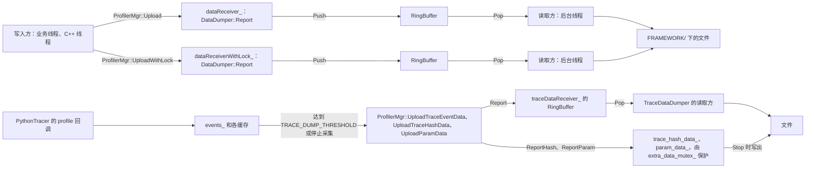
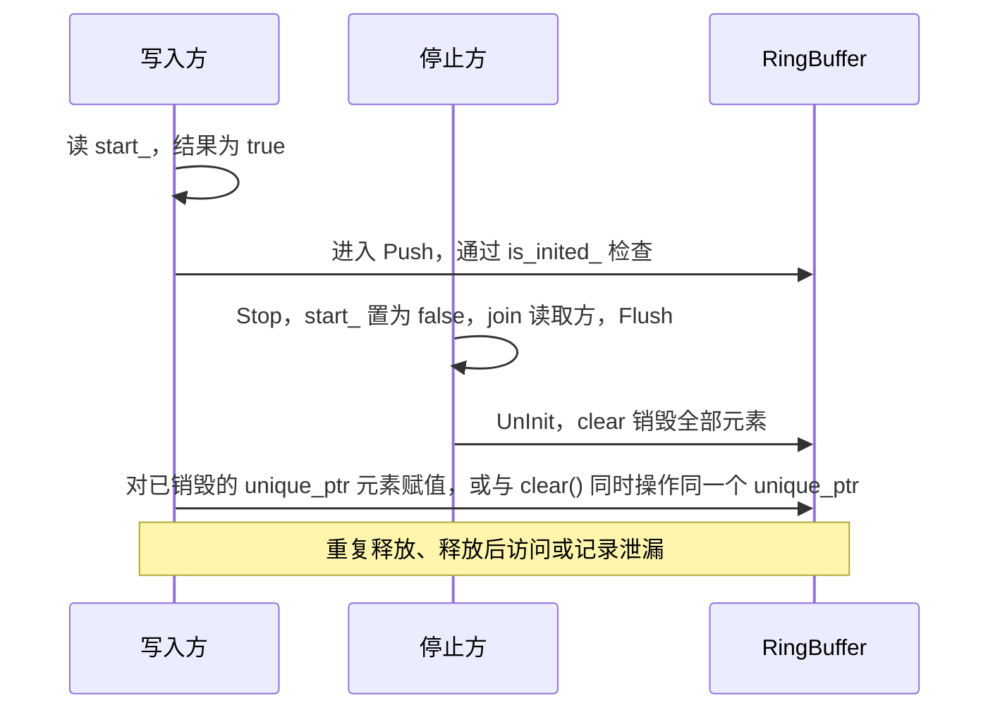
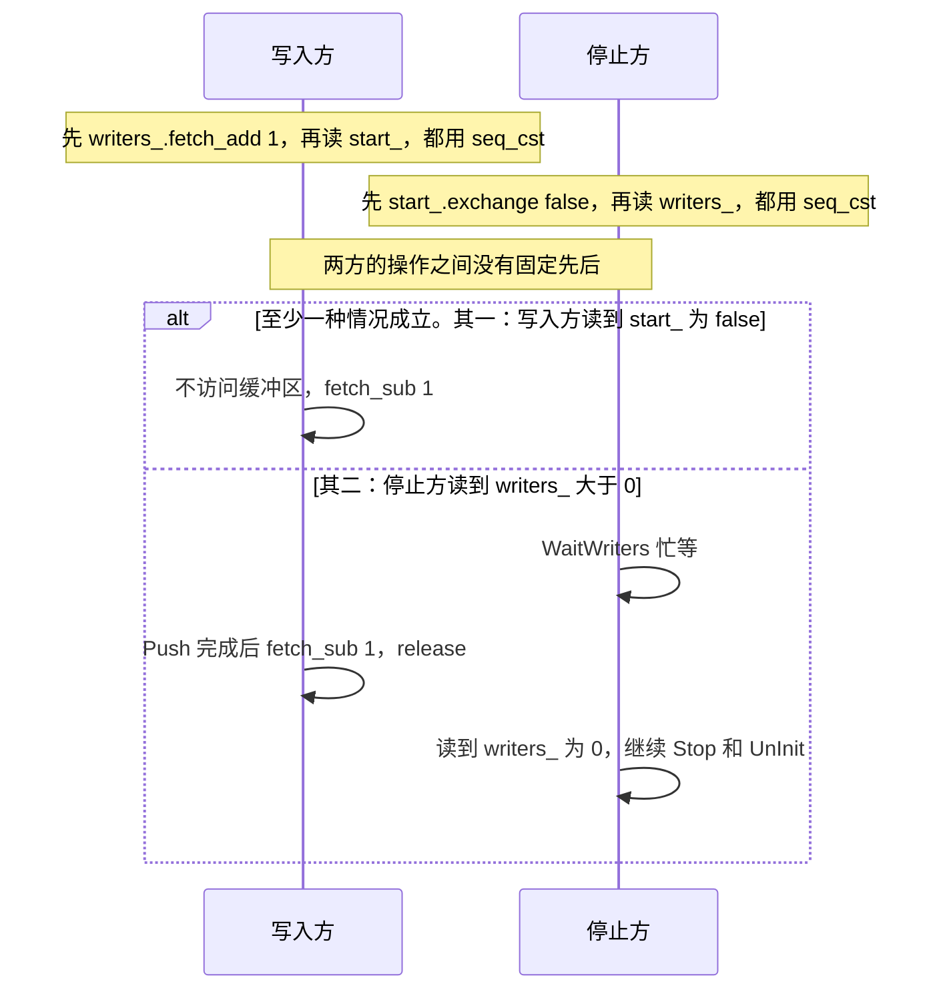
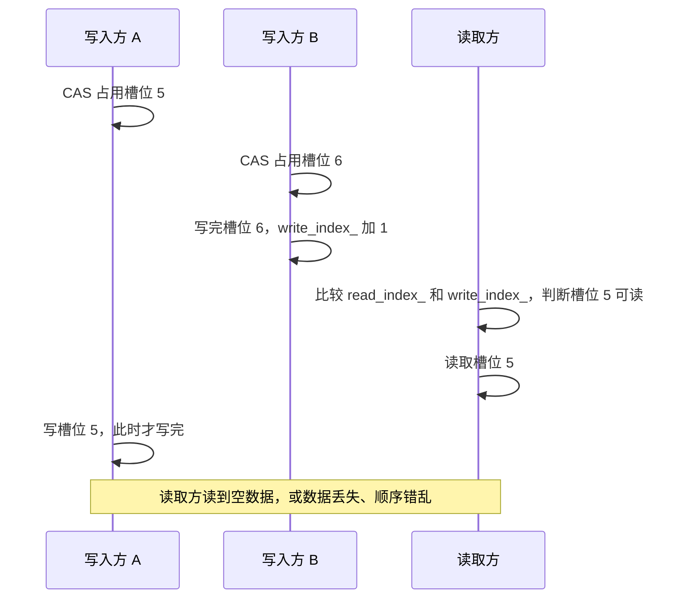
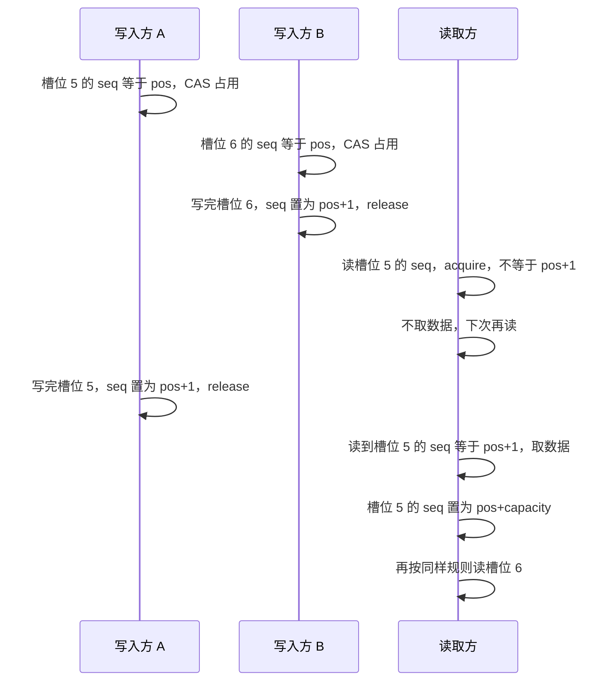

# torch_npu profiler 在 free-threaded Python 下的线程安全修复

本分支修复了 profiler 上报链路中的三处线程安全问题。这三处修改（`663e8ba`、`f36d74d`）只在 stub 的 C++ 单元测试中专门测试过。11-03 在 NPU 上复现了候选 1 的崩溃路径：`npu_check.py --stack` 在 `2148353` 上 SIGSEGV，栈顶 `ModuleInfo::ModuleInfo → PyObject_GetAttrString`。是否为使用方崩溃的原因，结论待定。本分支 `1ece90d` 已修改。11-06 用真实环境编译了含本分支全部代码修改的 `9f34a2a`，并在 NPU 上运行：`npu_check.py --stack` 正常退出；修改前的构建在同一环境中仍 SIGSEGV。这些运行中没有专门触发三处线程安全问题的测试。三个候选见 [README.md](README.md)。

- 代码：`yinwu01/torch_npu`，分支 `fix/profiler-thread-safety`。
- 基线：`113xiaoji/torch_npu` 的 `codex/r22-real-four-worker-20261027`（`d3216c2`，TorchNPU 2.13.0）。
- 修复提交：`663e8ba`（主体），`f36d74d`（异常路径的引用泄漏），`1ece90d`（候选 1：3.13 及以上用 `PyMapping_GetItemString` 读 `self`）。
- 术语见 [README.md](README.md) 的“术语”一节。

## 1. 结论

| 项目 | 内容 |
|---|---|
| 现象 | 使用方在 FT 构建下开启 `torch_npu.profiler`，进程 SIGSEGV。使用方没有提供调用栈。 |
| 使用方的判断 | “上报模块初始化竞态导致空指针访问”。这一判断没有核实。 |
| 找到的问题 | 上报链路中有 3 处线程安全问题。对应文件与基线 `46936d1`（TorchNPU 2.13.0）逐字节相同，所以问题不是 r22 分支引入的。 |
| 为什么 FT 下才暴露 | 有 GIL 时，多个 Python 线程基本依次执行，问题很少暴露。FT 构建下多个线程同时执行，问题就会暴露。 |
| 修改内容 | 4 个源文件，加一套压力测试。 |
| 验证结果 | stub 环境中，原代码 42 次场景运行全部失败，其中有 SIGSEGV。修复后 42 次全部通过。11-06 在 NPU 上编译并运行了含全部代码修改的 `9f34a2a`（torch 2.13.0、CPython 3.14t、CANN toolkit 9.1.0），`npu_check.py` 的三次运行都正常退出：单线程开 `--stack`；4 线程 × 20 次开 `--stack`；单线程不开 `--stack`（[progress.md](progress.md) 2026-11-06）。4 线程运行可能没有采集 worker 线程（推断），不作为候选 1 修复的证据。 |
| 未完成的验证 | 问题 1、2、3 的修改只在 stub 的 C++ 单元测试中专门测试过。NPU 上的运行没有专门触发这三处问题。修改前这三处问题在 NPU 上是否导致崩溃，结论待定。GIL 构建只做了编译检查。候选 1 的修改只在 3.14.3t 上运行过，3.13 没有测试。Optimizer 分支没有运行。开始采集后启动的线程是否被采集，结论待定。 |

测试的调用比 `ProfilerMgr` 的实际调用更密集，例如两个线程并发调用 `Stop`。所以原代码失败只说明这些路径有竞态。它不能说明使用方的崩溃来自哪一处。

上游 `Ascend/pytorch` master 的状态（2026-11-02 查看）：

- 问题 1、2：`ring_buffer.h`、`data_dumper.cpp` 只改过代码格式。逻辑与 2.13.0 相同，问题仍在。
- 问题 3：上游在 `ff5ad88d8a`（2026-10-29，"fix:profiler fix with_stack memory bug"）中重构了 `PythonTracer`。设计与本分支不同，逐项对照见 [analysis.md](analysis.md) 第 4.4 节。

## 2. 记录路径

开启 profiler 后，算子下发、内存分配、NPU 任务队列出队都会生成记录。下图是记录从写入方到文件的路径。



- `RingBuffer` 是固定长度的数组。写到末尾后，从开头继续写。
- 每个 `DataDumper` 有一个读取方。读取方取出记录，写入文件。
- `ProfilerMgr` 有三个上报器：`dataReceiver_`、`dataReceiverWithLock_`（`DataDumper`）和 `traceDataReceiver_`（`TraceDataDumper`）。
- 停止采集时，`ProfilerMgr::Stop` 对每个上报器依次调用 `Stop` 和 `UnInit`。`Stop` 停止读取方，并写完剩余记录。`UnInit` 释放缓冲区，并关闭文件。
- 开启 `with_stack` 等选项时，`PythonTracer`（`profiler_python.cpp`）在每个 Python 线程上安装 profile 回调。它内部有多个所有线程共用的容器和缓存。

## 3. 问题与修改

### 问题 1：停止采集时，写入方仍在访问正在销毁的缓冲区

涉及文件：`toolkit/profiler/src/data_dumper.cpp`、`toolkit/profiler/inc/data_dumper.h`、`toolkit/profiler/common/ring_buffer.h`。

**原代码**（已简化）：

```cpp
// 写入方
void DataDumper::Report(data) {
    if (!start_.load()) return;             // ① 检查是否在采集
    data_chunk_buf_.Push(std::move(data));  // ② 写入缓冲区
}
// RingBuffer::Push 内部：循环里先检查 is_inited_，CAS 占用槽位成功后才写 data_queue_[k]

// 停止方
Stop();    // start_ = false，等待读取方结束（join），再写完剩余记录（Flush）
UnInit();  // data_queue_.clear()：销毁缓冲区中的元素，并把大小置 0
```

**出错的执行顺序：**



原代码的 ASan 构建报出了 heap-use-after-free 和 double-free。

**其他相关问题：**

- `RingBuffer::is_inited_` 是普通 `bool`。多个线程同时读写它，按 C++ 标准属于未定义行为。
- `TraceDataDumper::ReportHash/ReportParam` 给 `unique_ptr` 成员赋值。停止方可能同时读这个成员。两者之间没有同步。
- `DataDumper::GatherAndDumpData`（`d3216c2` 的 `data_dumper.cpp` 第 83 行）和 `TraceDataDumper::CreateDumpDir`（第 235 行）各有一个函数内 `static bool create_flag`。两个 `DataDumper` 实例的读取方共用前一个。

**修改 1：写入方先登记，再检查。** 新增原子计数 `writers_`，记录当前处于 `Report` 内的写入方数量。

```cpp
void DataDumper::Report(data) {
    if (data == nullptr || !start_.load(relaxed)) return;  // 未采集时提前返回，开销与原来相同
    writers_.fetch_add(1);            // 登记
    if (start_.load()) {              // 再次检查
        data_chunk_buf_.Push(std::move(data));
    }
    writers_.fetch_sub(1, release);   // 注销
}
```

**修改 2：停止方先关闭采集，再等待写入方退出。**

```cpp
StopLocked():
    if (start_.exchange(false)) {  // 关闭采集
        WaitWriters();             // 忙等，直到 writers_ 为 0
        Thread::Stop();            // 等待读取方结束
    }
    Flush();                       // 写完剩余记录
UnInitLocked():
    StopLocked();                  // 确保已停止
    释放缓冲区，关闭文件
```

修改后的协议如下图。



为什么安全：

- 写入方先改 `writers_`，再读 `start_`。停止方先改 `start_`，再读 `writers_`。
- 这四个操作都用 `seq_cst`。所以下面两种情况至少有一种成立：写入方读到 `start_ == false`；停止方读到 `writers_ > 0`。
- 因此停止方不会在写入方访问缓冲区时释放它。
- 写入方的 `fetch_sub` 用 release。所以写入方对缓冲区的写入，在 `Flush` 和 `UnInit` 之前可见。

> [!WARNING]
> 不要把这四个操作的 `seq_cst` 改弱。改弱后，按 C++ 内存模型，上面的“至少有一种成立”不再有保证。
> x86 上原子读-改-写指令本身带完整内存屏障，所以压力测试测不出改弱（变异测试 25 次运行全部通过）。
> aarch64 等内存顺序更弱的平台上可能出错。这一点没有实测。修复后的代码在 aarch64 上运行过 `npu_check.py`，没有专门测试改弱 `seq_cst`。代码注释已写明“不能改弱、x86 和 TSan 下测不出”。

**修改 3：控制操作加锁。**

- `Init/Start/Stop/UnInit` 加互斥锁 `control_mutex_`。同一时间只有一个控制操作执行。
- 原因：两个线程同时调用 `Stop` 时，两个线程会同时从缓冲区读数据。缓冲区在修改前后都只支持一个读取方。
- `Report` 不获取这把锁。

**修改 4：其他。**

- `Start` 改为先置 `start_ = true`，再创建读取方线程。原代码顺序相反，读取方可能启动后立即读到 false 并退出。
- `ReportHash/ReportParam` 和对应的 Flush 用互斥锁 `extra_data_mutex_` 保护。这两个函数调用次数很少。
- `create_flag` 改为每个实例一份（`create_dir_flag_`）。
- `Flush` 按每次实际取出的条数循环，不再依赖 `Size()`。这样不会在未写完的槽位上忙等。
- 读取方的 `Run` 取不到记录时休眠。`DataDumper::Run` 仍读 `Size()`，但不再据此忙等。`TraceDataDumper::Run` 按取出结果判断。

### 问题 2：多个写入方同时写入时，读取方可能读到未写完的槽位

涉及文件：`toolkit/profiler/common/ring_buffer.h`。

**原代码**（已简化，省略 `is_quit_` 分支）：

```cpp
Push:
    CAS 占用 idle_write_index_，得到槽位 k
    data_queue_[k] = data                     // 写数据
    write_index_++                            // 可读条数加 1
Pop:
    if (read_index_ != write_index_) 读取 data_queue_[read_index_]
```

**出错的执行顺序：**



根本原因：`write_index_` 只记录已写完的总条数。读取方无法据此判断哪个槽位已写完。

**修改：** 改为每个槽位带序号的有界队列。写法是 Dmitry Vyukov 的 bounded MPMC queue 的单读取方用法。

- 每个槽位是 `{atomic<size_t> seq; T data;}`。初始化时 `seq` 等于槽位下标。
- 写入方读到 `seq == pos` 时，用 CAS 占用槽位。写完数据后，执行 `seq = pos + 1`（release）。
- 读取方只在读到 `seq == pos + 1`（acquire）时取数据。取完后执行 `seq = pos + capacity`，供下一轮使用同一下标的写入方。



结果：读取方只读已写完的槽位，并按占用顺序读取。

**接口变化：**

- `Init/UnInit/Push/Pop/Size` 的签名不变。调用方不需要修改。
- `Size()` 统计已占用但未取出的槽位，包括未写完的槽位。`write_index_ <= read_index_` 时返回 0。
- `RingBuffer::Init` 把容量向上取整到 2 的幂，最小为 2。
- 容量为 0 或过大时，`Init` 只记一条错误日志，不创建缓冲区。之后 `Push` 一律返回 false。

### 问题 3：`PythonTracer` 的共享状态没有同步

涉及文件：`profiler/profiler_python.cpp`。原代码依赖 GIL 保证同一时间只有一个线程执行。FT 构建下，多个线程会同时访问以下几处：

| 位置 | 问题 |
|---|---|
| 子线程注册 | `startOne` 向共享的 `std::deque thread_local_results_` 执行 `emplace_back`，没有加锁。 |
| 回调写缓存 | 每次 Python 函数调用都触发 profile 回调。回调写入 `events_`、`py_call_cache_`、`module_info_cache_` 等共享缓存。 |
| 控制操作 | `start/stop/clear` 与子线程的 `startOne/stopOne` 之间没有同步。 |
| 释放后访问 | 回调通过 `ctx->thread_local_result_->active_tracer_` 读 `ThreadLocalResult`。`clear()` 会释放 `ThreadLocalResult`。 |

修改分两部分。锁只在 FT 构建中生效。逻辑修改在两种构建中都生效。

**第一部分：锁。** 只在 FT 构建（`Py_GIL_DISABLED`）中启用。GIL 构建中这些锁是空函数。

| 锁 | 保护对象 | 规则 |
|---|---|---|
| `control_mutex_` | 让 `start/stop/clear` 依次执行；保护 `interpreter_` | 持有期间会执行 Python 代码。终结器或 `__getattr__` 可能再次调用 `start/stop/clear`。`PyMutex` 不可重入，所以同一线程重入时抛出异常，避免死锁。 |
| `registration_mutex_` | `thread_local_results_`、`start_py_call_info_`、会话计数 `session_` | 持有期间不调用 Python，不分配 Python 对象。 |
| `data_mutex_` | 回调写入的各缓存、`events_`、`ctx_tid_map_` | 同上。 |

> [!WARNING]
> 修改代码时遵守加锁顺序：`control_mutex_` → `registration_mutex_` → `data_mutex_` → `ProfilerMgr` 的上报。

使用 `PyMutex` 的原因：等锁时线程 detach，不阻塞 CPython 的 STW。

**第二部分：逻辑修改。** 两种构建都生效。

- `TraceContext` 的 `thread_local_result_` 改为 `std::atomic<PythonTracer*> tracer_`。`~ThreadLocalResult` 把它置空。回调只读 ctx 和 tracer，不再访问 `ThreadLocalResult`。
- `stop()` 在移除回调之前，在 `registration_mutex_` 内同时执行 `active_ = false` 和 `++session_`。原代码在移除回调之后才置 `active_ = false`。
- `startOne` 安装回调后，再检查一次 `session_`。如果 `session_` 已变化，说明 `stop()` 已执行，`startOne` 移除刚安装的回调。如果此时新会话已开始，`startOne` 重新注册一次（最多重试一次）。
- 回调的记录函数（`genPyCallHashId`、`recordPyCall`、`recordCCall`、`recordReturn`）都新增 `active_` 检查。`stop` 开始后不再记录。
- `recordStartStack` 在会话已停止时丢弃记录。
- `clear()` 改为在持有 GIL 时释放上下文对象。原代码不持有 GIL。
- `startOne` 多持有的一份 ctx 引用在 `663e8ba` 中加入。`f36d74d` 把手动 `Py_XDECREF` 改为局部对象析构时释放。所以 `recordStartStack` 抛出 Python 异常时，引用也会释放（例如某个 `nn.Module` 子类没有调用 `super().__init__`）。

结果：`stop()` 返回、且所有进行中的 `startOne` 都返回之后，没有线程仍安装着本 tracer 的回调。在此之前短暂存在的回调读到 `active_ == false`，不记录事件。`startOne` 持有的 ctx 引用保证 ctx 不会提前释放。

> [!NOTE]
> 上面的结果有一个前提：`sys.setprofile` 审计回调没有抛异常。按 `Python/legacy_tracing.c`，审计回调返回 -1 时，CPython 直接返回，不进入 STW，也不替换回调，只打印 unraisable 信息。
> 这时旧回调仍在。`stop()` 之后由 `active_ == false` 保证不记录事件。`clear()` 之后由已置空的 `tracer_` 保证不记录事件。`tracer_` 只在 `~ThreadLocalResult` 中置空，即 `clear()` 时。这一情况没有测试。

**FT 构建中的结构变化：**

- `start()` 给所有线程安装同一个共享 ctx（`shared_ = true`）。安装用 `PyEval_SetProfileAllThreads`，在 STW 期间完成。
- 共享 ctx 的 `start_py_call_info_`、`ctx_tid_map_` 改用线程 id 作为键（见 `ctxKey()`）。子线程自己注册的 ctx 仍用地址作为键。

GIL 构建中外部可观察的行为不变（推断，没有运行验证）。除 `clear()` 改为获取 GIL、3.13 及以上读 `self` 的改法（`1ece90d`）外，其余逻辑修改只在出现竞争时改变执行路径。

### 候选 1 的修改（`1ece90d`）

涉及文件：`profiler/profiler_python.cpp`。与线程无关，单线程、有 GIL 时同样成立。背景见 [analysis.md](analysis.md) 第 4.2 节。

- 原代码用 `PyDict_GetItemString` 读 `nn.Module` 帧和 `Optimizer` 帧的 `self`。3.13 起 `f_locals` 不是 `dict`，这个调用返回空指针，随后对空指针取属性而崩溃。CPython C API 的行为已验证。
- 3.13 及以上改用 `PyMapping_GetItemString`。返回的新引用用 `THPObjectPtr` 持有。3.13 以下保留 `PyDict_GetItemString`。
- 取不到 `self` 时，清除错误并跳过这条记录。
- 理由：`pyProfileFn` 没有 try/catch，C++ 异常不能从回调抛出。上游 master 在这里抛异常。出处：`1ece90d` 提交信息。
- 验证：11-03 在 NPU 上复现了 torch_npu 的崩溃（`2148353`）。11-06 在 3.14.3t 上、在 NPU 上重测，不再崩溃；修改前的对照构建仍崩溃。

## 4. 验证

运行依赖：Linux，g++（C++17，支持 `-fsanitize=thread`，本机为 11.4），Python 3.8 以上（只用标准库）。不需要 torch、CANN、NPU，不需要联网。

### 4.1 测试方法

测试代码在 [`test/cpp/profiler_thread_safety/`](../../test/cpp/profiler_thread_safety)。`ring_buffer.h`、`thread.h`、`data_dumper.h/.cpp`、`profiler_python.cpp` 原样编译。日志、torch、CPython、`ProfilerMgr` 头文件换成 `stubs/` 中的 stub。

| 场景 | 内容 |
|---|---|
| `rb` | 8 个写入方同时写入，1 个读取方同时读取。检查每条数据恰好读到一次、同一写入方的数据按顺序到达、内容完整。 |
| `dumper` | 多个线程循环调用 `Report`。主线程反复执行 `Init/Start/Stop/UnInit`。另一个线程随机调用 `Stop`。 |
| `trace` | 同上，对象是 `TraceDataDumper`，同时调用 `ReportHash/ReportParam`。 |
| `pytracer` | 多个线程执行 profile 回调和 `startOne/stopOne`。主线程反复执行 `start/stop/clear`。每次 `stop` 之后、进行中的 `startOne` 全部返回时，检查没有线程仍安装着回调。 |

- 编译方式：TSan 构建、ASan 构建、plain 构建。
- ASan 构建同时开启 UBSan（`-fsanitize=address,undefined`），UBSan 报告含 `runtime error:`。
- Linux 上 ASan 构建默认开启 LSan。`run.py` 也设置了 `detect_leaks=1`。
- `run.py` 把这几种 sanitizer 的报告都判为失败。所以一次 ASan 构建失败可能来自 ASan、UBSan 或 LSan。
- 每个场景重复 3 次。`rb` 场景的缓冲区容量：TSan 构建用 64 和 1024，ASan 构建用 64，plain 构建用 64 和 4096。
- 合计 TSan 构建 15 次、ASan 构建 12 次、plain 构建 15 次，共 42 次场景运行。
- 另有 7 次编译检查，其中一次是 GIL 路径的只编译检查。编译检查不计入下表。

### 4.2 结果

2026-11-02，本机，同一套测试。

| 被测代码 | 场景运行 | 失败 | 失败表现 |
|---|---|---|---|
| 原代码 `d3216c2` | 42 | 42 | TSan 数据竞争报告；ASan 报 heap-use-after-free 和 double-free；plain 构建 6 次 SIGSEGV、3 次 SIGABRT；`rb` 丢数据或顺序错乱；部分运行挂起直至超时 |
| 修复后 `f36d74d` | 42 | 0 | 无 |
| `1ece90d` | 35 | 0 | 无（出处：提交信息；stub 只编译 3.13 以下分支） |

`1ece90d` 一行在 2026-11-03 运行，数字来自提交信息。35 与 42 不同的原因未记录。

### 4.3 复现

在仓库根目录执行：

```bash
# 修复后的代码
python3 test/cpp/profiler_thread_safety/run.py --builds tsan,asan,plain --repeats 3

# 原代码：把 d3216c2 的源码导出到另一个目录，用 --source-root 指定
mkdir -p /tmp/orig && git archive d3216c2 torch_npu | tar -x -C /tmp/orig
python3 test/cpp/profiler_thread_safety/run.py --source-root /tmp/orig --builds tsan,asan,plain --repeats 3 --timeout 30
```

在共享服务器上，用 `systemd-run --user --wait --collect -- bash -c '...'` 单独运行。这样挂起的测试进程不影响当前终端。

### 4.4 测试覆盖不到的内容

- stub 与真实 CPython 3.14 不完全一致。真实的 `PyEval_SetProfile` 会触发审计回调。`ModuleInfo`、`parseModuleParams` 调用的 CPython 接口在 stub 中从不报错，所以测试不覆盖它们抛 Python 异常的路径。
- GIL 路径只编译，不运行。
- stub 只编译 3.13 以下的分支，`1ece90d` 的 3.13 及以上分支只有 NPU 运行覆盖。
- `ProfilerMgr` 没有编译进测试。
- 测试检出回归的能力有限。变异测试每项 25 次运行：去掉 `WaitWriters` 失败 2 次；去掉 `Report` 中的二次检查失败 1 次；恢复原来的 `Run` 循环失败 0 次；把 `seq_cst` 改弱失败 0 次。完整列表见 [learning.md](learning.md) A4.3。

> [!CAUTION]
> 按默认的每项 3 次运行做回归测试，很可能漏掉上面这类回归。修改问题 1 的代码时，对照本文第 3 节逐条检查。

## 5. 行为变化

### 5.1 所有构建

| 变化 | 原因 |
|---|---|
| 采集期间每次上报多两次原子读-改-写（`writers_` 加 1、减 1）。多线程上报时，这两次操作在同一缓存行上争用。`writers_` 已用 `alignas(64)` 与 `start_` 分开存放。 | 问题 1 的登记计数 |
| 每个槽位从 8 字节变为 16 字节。两个 2^20 槽位的缓冲区合计从 16 MB 增至 32 MB。 | 问题 2 的槽位序号 |
| 可用容量从 capacity-1 变为 capacity。非 2 的幂的容量向上取整。 | 新队列的写法 |
| 采集运行中调用 `Init`：记一条错误日志，先停止并把数据写完到旧路径，再按新路径初始化。原代码直接在运行中的缓冲区上重新分配。 | 避免在写入方访问时重新分配缓冲区 |
| `UnInit` 遇到仍在运行的上报器时，先停止并写完数据。 | 析构路径同样需要安全 |
| 3.13 及以上，取不到 `nn.Module` 或 `Optimizer` 帧的 `self` 时跳过该记录。原代码对 NULL 取属性而崩溃。 | 候选 1 |

### 5.2 只影响 FT 构建

| 变化 | 原因 |
|---|---|
| 停止采集时，清除所有线程的 profile 函数，包括其他工具（如 cProfile）设置的。 | FT 构建下无法安全读取其他运行中线程的回调。只能用 `PyEval_SetProfileAllThreads` 在 STW 期间统一清除。 |
| 开始采集时只记录当前线程已有的调用栈，不应用 `max_threads`。 | FT 构建下不能切换到其他运行中的线程遍历调用栈。 |
| 开启 `with_stack` 时 Python 调用变慢，线程越多越明显。 | 每次 Python 调用至少获取两次 `data_mutex_`（`genPyCallHashId`、`recordPyCall` 各一次）。 |

`with_stack` 回调吞吐的测量（stub 环境，2026-11-02，3 次运行的范围）：

- 1 个线程每秒 418 万到 419 万次。6 个线程合计每秒 124 万到 141 万次。
- 只测了修复后的代码，没有原代码对照。测试只走缓存命中路径。
- stub 用 `std::mutex` 模拟 `PyMutex`，不含真实 CPython 的线程挂起和恢复开销。测试机是共享服务器，有噪声。
- 日志在作者本机，不在仓库中（见 [analysis.md](analysis.md) 附录）。
- [analysis.md](analysis.md) 第 5.4 节有一组本分支与上游的吞吐对照。那组用另一套 stub 和另一次运行，两组数字不能互相换算。

## 6. 未处理的问题

| 问题 | 说明 |
|---|---|
| host regions 的 worker 线程上的算子可能采集不到 | 算子回调用 `addThreadLocalCallback` 注册（`npu_profiler.cpp:260`），只对持有 profiler 线程状态的线程生效。worker 如果在 profiler 启动前创建，profiler 不记录它的算子。worker 的数量和创建时机没有核实。影响是结果缺少这些算子数据，没有观察到崩溃。 |
| `with_stack` 在 FT 构建下的锁争用 | 彻底解决要改为每个线程一份事件缓冲和缓存。上游 master 已是这种结构。上游每个事件仍获取一次全局 `results_mutex_`，次数更少、持有时间更短，见 [analysis.md](analysis.md) 第 4.4、5.4 节。 |
| `ProfilerMgr` 的 `mstx_domain_include_/exclude_` 有竞态 | `Start/Stop` 修改这两个 `std::vector` 时，其他线程可能在 `IsMstxDomainEnabled` 中读取。 |
| `ProfilerMgr` 的其他非原子成员 | `Start/Stop/Init/Finalize` 写入 `path_`、`profConfig_` 等成员。多个线程同时调用这些控制函数时没有保护。 |
| GIL 构建中 `record_params_` 沿用到下一次采集 | 上游原有的问题。修复会改变 GIL 构建的行为，所以没有改。 |
| fork 出的子进程中停止采集可能无限等待 | fork 时如果有写入方在 `Report` 中，子进程继承的 `writers_` 永远大于 0，`WaitWriters` 不返回。代码注释已写明。 |
| 一次 `startOne` 期间经历两轮完整的 stop/start 时，profiler 在最新一轮会话中不采集该线程 | `startOne` 只重试一次。代码注释已写明。 |
| 开始采集后启动的线程是否被采集 | 结论待定。`npu_check.py` 的 4 线程运行在 `profile()` 内启动 worker 线程，这些线程可能不被采集（推断）。 |
| 崩溃路径 `PythonTraceback::gather` | 出处已丢失（测试方找不到 `WORK_REPORT.md`），原因未查明。 |

## 7. 接手后的步骤

1. 按 [analysis.md](analysis.md) 第 7.1 节确认崩溃出在哪一处。候选 1 的崩溃路径已在 NPU 上复现（单线程、`--stack`），是否为使用方崩溃的原因，结论待定。候选 2、3 结论待定。本分支 `1ece90d` 已补上 `b2e659d62f` 的 `PyMapping_GetItemString` 改法，另加判空（`b2e659d62f` 没有判空，见 [analysis.md](analysis.md) 第 7.1 节“第 4 步的修改做法”后的警告），11-06 重测不再崩溃。
2. 决定合入方式：
   - 问题 1、2 的修改（`ring_buffer.h`、`data_dumper.h/.cpp`）可以移植到上游 master。上游这两处逻辑与 2.13.0 相同，但做过 clang-format。补丁不能直接 `git apply`，要手工合入。这些修改没有在 master 上编译过。
   - 问题 3 建议以上游 `ff5ad88d8a` 为基础，并补四处修改。理由和修改内容见 [analysis.md](analysis.md) 第 7.3 节。
   - 上游方案的代价：依赖 CPython 私有 API `_PyEval_StopTheWorld`；同线程重入时死锁。见 [analysis.md](analysis.md) 第 4.6 节。
3. 在 GIL 构建上运行原有的 profiler 测试（`test/profiler/`），确认行为不变。

## 8. 改动文件

| 文件 | 内容 |
|---|---|
| `torch_npu/csrc/toolkit/profiler/common/ring_buffer.h` | 问题 2：每个槽位带序号的有界队列 |
| `torch_npu/csrc/toolkit/profiler/inc/data_dumper.h` | 问题 1：新增 `writers_`、`control_mutex_`、`extra_data_mutex_`、`create_dir_flag_` |
| `torch_npu/csrc/toolkit/profiler/src/data_dumper.cpp` | 问题 1：登记、等待、加锁的停止流程 |
| `torch_npu/csrc/profiler/profiler_python.cpp` | 问题 3：FT 构建下加锁、会话计数、ctx 生命周期；候选 1：3.13 及以上读 `self`（`1ece90d`） |
| `test/cpp/profiler_thread_safety/` | 压力测试、stub 头文件、运行脚本 `run.py` |
